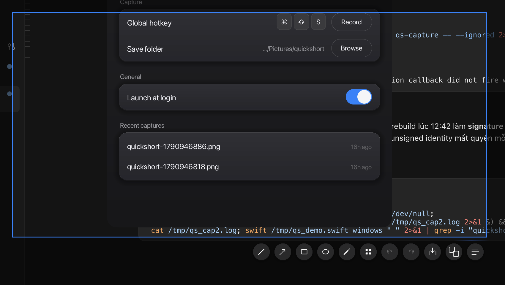

<div align="center">
  
  <h1>Quickshort</h1>
  <p><strong>Region screenshots with annotations and OCR — in Rust, native all the way down.</strong></p>
  <p>
    <a href="https://github.com/truongnat/quickshort/releases"></a>
    <a href="https://github.com/truongnat/quickshort/actions/workflows/release.yml"></a>
    
  </p>
</div>

<div align="center">
  
</div>

Press the global hotkey, drag a region — even across monitors — then save a
pixel-perfect PNG, copy it, or pull its text out with the OS-native OCR
engine. Draw on it first if you like. No Electron, no runtime, no model
downloads.

## Features

- **Multi-monitor selection** — drag across monitor boundaries; per-monitor
  crops are stitched through a virtual coordinate space
- **Full physical resolution** — Retina and mixed-DPI displays are captured
  and stitched at native framebuffer pixels, never downsampled
- **Annotations** — pen, arrow, rect, ellipse, marker, text, pixelate,
  undo/redo, stroke sizes, color palette — rendered at output resolution and
  confined to the captured region. Text gets real font sizes (12–48), a bold
  toggle, a proper editing box (arrows, selection, ⌘A) and Vietnamese IME
  input. Shapes and text stay editable blocks: the Select tool picks, drags
  and deletes them
- **Link sharing** — one click uploads the shot as WebP (q95, roughly
  half a PNG's size) to a Cloudflare Worker (`relay/share/`) and copies
  an unguessable URL that expires in 3 days. No account, no local
  server, and the process does not need to stay alive
- **OCR with per-OS engines** — Vision `VNRecognizeTextRequest` on macOS,
  `Windows.Media.Ocr` on Windows, Tesseract on Linux with script
  auto-detection (`ocr_lang = "auto"`, OSD pass picks eng/jpn/vie/…);
  nothing ships in the binary
- **Resident tray app** — menu-bar icon, global hotkey, launch at login,
  recent captures, auto-update
- **Settings window** — paged preferences (Capture, General, Shortcuts,
  Appearance, Storage, About): rebindable ⌘-action keys, accent color,
  retention policy for old captures, one-click update install
- **One-shot CLI** — `quickshort --capture` fits into scripts and window
  manager keybinds

## Install

### macOS

**DMG** — grab `Quickshort-v*-macos.dmg` from
[Releases](https://github.com/truongnat/quickshort/releases), open it, drag
**Quickshort** into Applications.

**Homebrew** (custom tap):

```bash
brew tap truongnat/tap
brew install --cask quickshort
```

> **Unsigned build** — no Developer ID signature or notarization. On first
> launch, right-click the app → **Open** → **Open** once. The cask strips
> quarantine automatically. The app is signed with a stable self-signed
> identity purely so macOS keeps your permission grants across updates.

Required permissions (System Settings → Privacy & Security):

- **Screen Recording** — needed to capture anything
- **Accessibility** — needed for the global hotkey

**Updates** — the app checks GitHub Releases once a day in the background;
the tray item becomes *Update to vX — Restart to Install*. Or: tray menu →
**Check for Updates…**, or `brew upgrade --cask quickshort`.

### Linux

**AppImage** — grab `Quickshort-Linux.AppImage` from
[Releases](https://github.com/truongnat/quickshort/releases), `chmod +x`,
run. Bundles the tray dependencies (gtk plugin).

**Debian / Ubuntu** — `quickshort_amd64.deb` installs to `/usr/bin` with a
`.desktop` entry and icon:

```bash
sudo dpkg -i quickshort_amd64.deb
```

Or from source — `./install.sh` installs missing system deps on
Debian/Ubuntu (pipewire/spa/clang dev packages for the build, plus
`tesseract-ocr` + language packs, `wl-clipboard`, `libnotify-bin` at
runtime; extra OCR languages via `QS_OCR_LANGS`), builds release →
`~/.local/bin` and registers a GNOME custom shortcut via `gsettings`
(default `Ctrl+Alt+Q`). On non-GNOME desktops it installs the binary
only — bind it yourself.

### Windows

`Quickshort-Windows-Setup.exe` under
[Releases](https://github.com/truongnat/quickshort/releases) — NSIS
installer: Program Files install, Start Menu shortcut, uninstaller entry.
Unsigned, so SmartScreen warns once (**More info → Run anyway**). Runs as a
tray app, no console window. Or build from source
(`cargo build --release -p qs-app`).

## Usage

```bash
quickshort                              # resident tray app (default)
quickshort --capture                    # one-shot: select -> action -> exit
quickshort --capture --delay 2          # wait first (menus, tooltips)
quickshort --capture --out ~/shots/a.png
```

| Context | Shortcut | Action |
|---|---|---|
| Anywhere | `⌘⇧S` macOS/Linux, `PrintScreen` Windows (configurable) | Start a selection |
| Selection made | `⌘S` / `⌘C` / `⌘T` / `⌘L` (rebindable) | Save / copy / OCR / share link → clipboard |
| Selection made | `⌘Z` / `⌘⇧Z` (rebindable key) | Undo / redo an edit |
| Block selected | `Delete` / `⌫` / `Esc` | Remove block / deselect |
| Text draft | `Enter` / `Esc` | Commit / discard |
| Text draft | `⌘A`, `⇧`+arrows, `←→`, `⌫`/`⌦` | Select, move caret, delete |
| Selection made | `Esc` | Cancel |

The tray menu offers Capture Region, Recent Captures, Open Screenshots
Folder, Check for Updates, Launch at Login, Settings and Quit. Settings
also live in `~/.config/quickshort/config.toml`:

```toml
hotkey = "CmdOrCtrl+Shift+S"   # global-hotkey syntax; "PrintScreen" is
                               # the Windows default — falls back to
                               # Ctrl+Shift+S if the shell owns it
# save_dir = "~/Pictures/quickshort"
launch_at_login = false
auto_update = true
recent_max = 8                 # entries in the tray menu
accent = "blue"                # blue/purple/pink/orange/green/gray
copy_after_save = false        # also put the PNG on the clipboard
ocr_lang = "auto"              # Linux tesseract: "auto" detects the
                               # script, or pin e.g. "eng+jpn"
keep_days = 0                  # auto-delete captures older than N days
key_save = "s"                 # overlay ⌘+key actions
key_copy = "c"
key_ocr = "t"
key_share = "l"
key_undo = "z"                 # ⌘z undo, ⌘⇧z redo
```

The selection toolbar docks to whichever edge of the region has room.
Clicking away starts a new selection; Esc or a click without dragging
cancels. Saved files go to `~/Pictures/quickshort/quickshort-<ts>.png`.

## How it works

```
capture every monitor into RAM
  → dimmed overlay windows (one per monitor)
  → selection in global virtual coordinates
  → map through each monitor's origin + DPI scale
  → stitch per-monitor crops on a worker thread
```

| Crate | Role |
|---|---|
| `qs-core` | geometry + stitching, pure |
| `qs-capture` | per-OS backends behind `ScreenCapture` |
| `qs-overlay` | winit + softbuffer, SDF-drawn toolbar, annotation layers, text via embedded Inter (ab_glyph) |
| `qs-ocr` | native text extraction |
| `qs-app` | CLI + resident tray app (`tray-icon`/`muda`/`global-hotkey`), updates |

Capture backends:

| Platform | Backend |
|---|---|
| macOS 14+ | `SCScreenshotManager` per-display one-shot at framebuffer pixels |
| Windows | GDI BitBlt per monitor, `PER_MONITOR_AWARE_V2` |
| GNOME Wayland | `org.gnome.Mutter.ScreenCast` → PipeWire shm frames, in-process |
| Other Wayland (KDE, wlroots) | `org.freedesktop.portal.ScreenCast` → PipeWire |
| X11 | RandR layout + `GetImage` |

On GNOME Wayland there is no portal dialog and no subprocess — the backend
talks to mutter's private ScreenCast API (the same one the GNOME portal
uses internally), then reads shared-memory buffers from PipeWire, one
connection multiplexing all monitor streams. Other compositors go through
`xdg-desktop-portal`: the compositor shows a consent dialog once, and on
portals supporting `persist_mode` (KDE 5.24+) a stored restore token makes
later captures dialog-free. `QS_CAPTURE=portal|mutter|x11` forces a backend.

OCR on Linux runs the system `tesseract` binary: in `auto` mode an OSD
pass detects the script and maps it to the installed language packs
(missing packs fail loud with the exact `apt` package to install), and
CJK output gets its artificial word spacing collapsed. Wayland capture
pokes a 1x1 XWayland window mid-screen because mutter only produces
frames on damage, and MemFd/DmaBuf buffers are mmap'ed directly.

## Development

```bash
cargo test                                       # unit tests
cargo test -p qs-capture -- --ignored            # real capture (needs Wayland/macOS)
cargo run -p qs-app                              # resident app
cargo run -p qs-app -- --capture                 # one-shot
```

Release packaging: `packaging/macos/release.sh` runs the full pipeline —
release build (universal when both rustup targets exist), `Quickshort.app`
bundle, self-signed identity (`packaging/macos/gen_signing_cert.sh`), zip +
dmg + sha256 into `dist/`. Tagging `v*` triggers the GitHub workflow, which
does the same and publishes a GitHub Release.

## Support

Free and open source, built in spare time. If Quickshort saves you time:

- **[GitHub Sponsors](https://github.com/sponsors/truongnat)** — international, zero fees on personal sponsorships
- **VietQR** — MB Bank `0969069035` · ĐÀO QUANG TRƯỞNG (scan with any VN banking app)


## Known limits

- Mutter inhibits screencast while the screen is locked
- Wayland needs one overlay window per monitor (no global window
  positioning); pointer grab carries the selection across monitors
- Wayland has no global hotkey API — run the resident app for the tray
  (needs an AppIndicator extension on GNOME) and bind
  `quickshort --capture` as a desktop custom shortcut
- Unsigned macOS builds: first launch needs one right-click → Open; the
  self-signed identity keeps TCC grants across updates but is not a
  Developer ID
